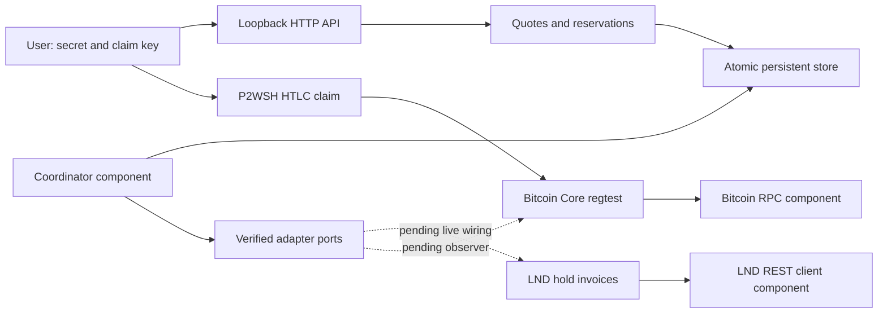

# LQWD Swap Engine v0.1

Experimental TypeScript components for non-custodial Lightning-to-Bitcoin reverse
submarine swaps on Bitcoin regtest. **This milestone is incomplete: live swap
creation is disabled. It is neither audited nor production-ready.**

## Project overview and business motivation

A reverse swap lets a user move Lightning liquidity to a Bitcoin output while
keeping their channel open. A held Lightning payment and an on-chain P2WSH HTLC
share the same SHA-256 payment hash. The user generates the secret locally. The
provider learns the secret only when the user claims the on-chain output, then
uses it to settle the held Lightning payment. This implementation does not accept
custodial deposits or forward ordinary payments as a substitute for a swap.

## Architecture



See [protocol invariants and architecture](docs/architecture.md),
[security limitations](docs/security.md), and [verification results](docs/results.md).

## Supported rails and development status

Bitcoin regtest and Lightning regtest have implemented protocol components.
There is no working live service yet. Liquid, Rootstock, Arkade and RGB are
**planned only**; no adapters for those rails exist.

| Component | Implemented | Still required |
| --- | --- | --- |
| LND | Local TLS REST client, hold/create/lookup/cancel/settle, subscription, balance inspection | Live v0.21.6-beta compatibility tests, reconnect worker |
| Bitcoin | P2WSH construction and verification, signed claim/refund, PSBT lockup preparation, broadcasting, active-chain confirmation lookup | Live consensus tests, spending-transaction discovery, reorg tracking |
| Coordinator | Durable action intents, accepted-HTLC checks, confirmation gates, settlement recheck, conservative recovery | Production adapter wiring, deterministic action reconciliation, automatic refund orchestration |
| Liquidity | Amount limits, fee budgets, monetary reservations under one writer | Outpoint journal, reconciliation against external wallet activity |
| API | Explicit schemas and all five routes | Live reverse-swap creation intentionally returns 503 |
| Keys | User and provider keys are separate; offline builders accept caller keys | Secure persistent provider refund-key manager and client wallet |

## Regtest setup

Use Node.js 22 or later (validated here with Node.js 24.19.0). Run inside the
existing Ubuntu VM so loopback addresses refer to the existing nodes. Do not reset
chain data, create replacement wallets, overwrite LND configuration, or close channels.

```bash
npm ci
npm run build
npm test
cp .env.example .env
# Review paths locally; .env contains file paths, never copied credentials.
# Node does not automatically load .env:
node --env-file=.env --import tsx scripts/inspect.ts
node --env-file=.env --import tsx src/main.ts
```

The sample uses Bitcoin cookie authentication with the existing `lqwd-lab` wallet.
LND must already have a **local HTTPS REST listener** (usually 8080), a matching
TLS certificate and a readable macaroon. The supplied gRPC port 10009 is not a
REST endpoint. Discovery and configuration are manual; this project never edits
LND configuration. Use a suitably scoped macaroon when supported; the example
references the existing admin macaroon locally for lab compatibility.

The API binds only to `127.0.0.1:3000`. `ENABLE_LIVE_SWAPS=true` causes startup to
fail, rather than bypassing the incomplete observer/recovery boundary. Health
reports component mode; it does not claim the nodes are ready. For live preflight
and exact next steps see [the VM runbook](docs/regtest-runbook.md).

## API documentation

All amounts are integer satoshis; timestamps are Unix milliseconds. Requests use
`Content-Type: application/json`, strict object schemas, and an 8 KiB body limit.
Schemas are in `src/api/schemas.ts`. Responses never contain private keys or a
preimage. Quotes are estimates; they do not reserve liquidity.

| Method and route | Request | Response |
| --- | --- | --- |
| `POST /v1/quotes` | `{ "amountSats": 50000 }` | 201: quote below |
| `POST /v1/swaps/reverse` | `{ "quoteId": "UUID", "paymentHash": "64 lowercase hex", "claimPublicKey": "compressed hex key" }`, `Idempotency-Key: unique-key` | 503: `LIVE_SWAPS_DISABLED_OBSERVER_AND_RECOVERY_NOT_VERIFIED` |
| `GET /v1/swaps/:id` | UUID path | 200: public state, quote, contract, optional invoice and transaction IDs; 404 if absent |
| `GET /v1/health` | None | 200: `{ "status": "components-only", "liveSwapsEnabled": false, "network": "regtest" }` |
| `GET /v1/liquidity` | None | 200: available onchainSats/incomingSats after reservations; 503 if nodes unavailable |

```bash
curl -s http://127.0.0.1:3000/v1/health
curl -s -X POST http://127.0.0.1:3000/v1/quotes \
  -H 'Content-Type: application/json' -d '{"amountSats":50000}'
```

The 50,000-sat quote has `serviceFeeSats: 750`, `invoiceSats: 50750`,
`fundingReserveSats: 1000`, and `claimFeeSats: 500`, plus a random `id` and
`expiresAt` two minutes ahead. The HTLC principal is 50,000 sats; a claim using
the suggested fee pays the destination **49,500 sats**. The provider pays the
funding miner fee from its service proceeds. The claim fee is an estimate that
the client must independently assess. Amount limits are 10,000–1,000,000 sats.

Core swap creation is idempotent: the same key and request return the existing
operation, including after quote expiry. Reusing a key with different parameters
fails. A quote and a payment hash can each be used only once. No public request
currently creates a swap or invoice; component tests populate operations directly.

## Swap lifecycle

The happy path is `CREATED → QUOTED → INVOICE_CREATED → INVOICE_ACCEPTED →
LOCKUP_BROADCAST → LOCKUP_CONFIRMED → CLAIM_DETECTED → LIGHTNING_SETTLED → COMPLETED`.

Unfunded operations can become `EXPIRED` or `FAILED` only without an uncertain
action. Funded operations retain reservations and may enter `REFUND_PENDING`.
`REFUNDED` is reserved for a future verified refund observer; it is not currently
automatically reachable. Ambiguous outcomes enter `MANUAL_REVIEW` on recovery;
that state retains reservations and cannot automatically resume.

An RPC acknowledgement cannot complete a swap. The coordinator requires a
confirmed claim spending the precise outpoint, extracts and hashes its preimage,
settles the held invoice, observes `SETTLED`, and checks confirmation again before
completion. The adapter's consensus evidence is a trust boundary; offline tests
use explicitly fake ledger/invoice ports, not real consensus.

## Liquidity requirements

The provider needs confirmed, safe, spendable on-chain UTXOs and active inbound
Lightning capacity. The reservation calculation subtracts a 10,000-sat wallet
reserve, each active swap's principal plus 1,000-sat funding budget, and each
active invoice's full value. Failed liquidity checks reject creation. Reservations
are persisted within the same serialized transaction as swap creation.

This is conservative monetary accounting, not an outpoint allocator. Core's
`lockUnspents` additionally locks selected inputs during funding preparation. A
dedicated wallet-use policy and durable outpoint reconciliation are required
before live orchestration. Pending HTLCs may be conservatively counted twice.
Channel totals do not guarantee a route or sufficient capacity on one path.

## Automated tests and reproducible offline demo

```bash
npm run build
npm test
npm run demo
npm run secrets:check  # after git init and staging
```

The demo is a named test using a real signed 50,000-sat Bitcoin HTLC transaction
and fake Bitcoin/LND ledger adapters. It verifies cryptographic linkage and the
coordinator lifecycle. **It neither sends a Lightning payment nor broadcasts a
Bitcoin transaction.** A live regtest demo is not delivered in this milestone;
the missing work is itemized in the runbook.

Actual results on November 12, 2026: TypeScript validation passed; **27/27 tests
passed**. Coverage includes claim/refund signatures, wrong preimages/keys, fee and
timeout limits, insufficient liquidity, concurrent reservations, duplicate events
and requests, failed payment/broadcast/claim cases, unconfirmed transactions,
restart handling, corrupt state, HTTP schemas and the live funding gate.
Node preflight failed because the Ubuntu VM and local credential paths are
unavailable in this Windows workspace. No live-node test succeeded. See
[the complete results and phase status](docs/results.md).

## Security and known limitations

This software is experimental and unaudited. Do not fund it with mainnet BTC.
There is no reorg-aware chain observer, durable provider key service, automatic
refund sender, fee bumping, client payment tracker, or automatic reconciliation
of uncertain external actions. Restart recovery stops affected swaps for manual
review. The API has no authentication or rate limiting and must remain local.
The state database is single-host and is not suitable for multiple replicas.
See [all currently known security limitations](docs/security.md).

## Roadmap

1. Validate Core/LND adapters inside the existing VM and add real consensus tests
   for correct and invalid claim/refund witnesses and timelocks.
2. Add secure refund-key persistence and independently verifiable client tooling.
3. Add block/mempool spend discovery, disconnect/reorg handling, and deadline worker.
4. Journal exact UTXOs and external actions; implement deterministic restart recovery.
5. Automate confirmed refunds and cancellation; implement fee bumping and budgeting.
6. Wire adapters into the API, then execute and record an actual 50,000-sat
   reverse swap and failure/restart runs without closing the existing channel.
7. Obtain independent protocol/security review before considering any broader network.
8. Evaluate Liquid, Rootstock, Arkade and RGB as separate future designs.

## GitHub publication, ownership and licensing

The current repository is local. The connected GitHub account is `Truja503`, but
the connector cannot create repositories and GitHub CLI was not installed in the
execution environment. No remote repository or push is claimed. After installing
GitHub CLI, run these commands from this directory:

```bash
gh auth login
gh auth status
npm run secrets:check
gh repo create Truja503/lqwd-swap-engine --private --source=. --remote=origin --push
gh repo view Truja503/lqwd-swap-engine --json nameWithOwner,visibility,url
```

If the repository already exists, verify it is private before setting an origin
or pushing. Never push to a public repository. `LICENSE` reserves all rights;
no public-source license has been selected. Ownership and assignment require the
applicable written agreement. Dependencies retain their own licenses.
