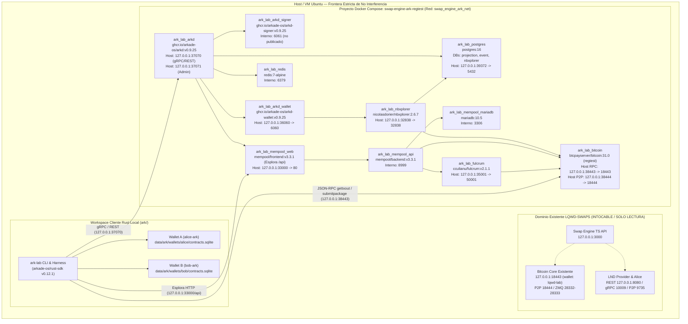
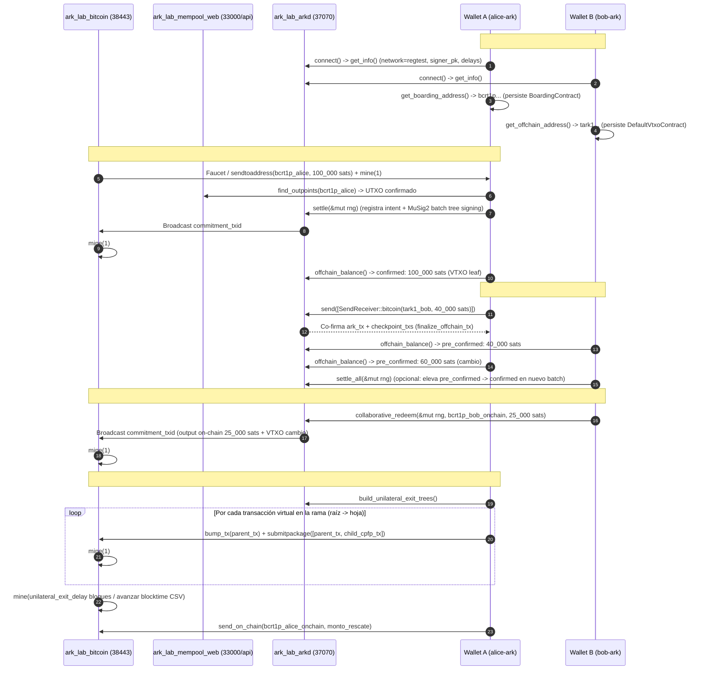

# Arquitectura del Laboratorio Arkade Regtest Aislado (`arkd` + `arkade-os/rust-sdk`)

> **Alcance y estado (#47 — `[ARK][01][P1]`):** Especificación arquitectónica entregada para cerrar [#47](https://github.com/Truja503/swap-engine/issues/47) y guiar la ejecución local de [#48](https://github.com/Truja503/swap-engine/issues/48) a [#54](https://github.com/Truja503/swap-engine/issues/54) bajo la épica [#46](https://github.com/Truja503/swap-engine/issues/46). Este diseño mantiene **aislamiento total** respecto a `LQWD-SWAPS`: no toca `src/`, `src/web`, la API HTTP (`127.0.0.1:3000`), el nodo Bitcoin Core existente (`127.0.0.1:18443`, wallet `lqwd-lab`) ni los nodos LND (`8080`, `9735`, `10009`).

---

## 1. Visión General y Frontera de Aislamiento

El objetivo de la épica [#46](https://github.com/Truja503/swap-engine/issues/46) es demostrar en un entorno **Bitcoin regtest exclusivo y reproducible** el ciclo de vida completo de fondos off-chain en **Arkade (Ark)**:

1. Operador Arkade (`arkd v0.9.25`), firmante separado (`arkd-signer v0.9.25`), wallet on-chain del operador (`arkd-wallet v0.9.25`), indexadores (`nbxplorer`, `fulcrum`, `mempool`) y nodo `Bitcoin Core 31.0` propio.
2. Dos wallets cliente independientes (**Wallet A / `alice-ark`** y **Wallet B / `bob-ark`**) construidas con el SDK oficial en Rust (**`arkade-os/rust-sdk v0.12.1`**) y persistencia local SQLite (`SqliteContractStore`).
3. **Boarding (On-chain BTC → Ark VTXO)**, **Transferencia off-chain (Wallet A → Wallet B)** y **Offboarding (Ark VTXO → On-chain BTC, cooperativo y unilateral)** con evidencia verificable en la cadena local.
4. Propuesta de contrato tipado **`ArkAdapter`** (#54) para revisión futura, **sin implementar swaps Ark ↔ Lightning ni modificar la máquina de estados actual**.



---

## 2. Justificación de Estrategia de Aislamiento (#47)

El criterio de aceptación de [#47](https://github.com/Truja503/swap-engine/issues/47) exige evaluar y justificar entre:
1. Reutilizar el `Bitcoin Core` existente de la VM (`127.0.0.1:18443`, wallet `lqwd-lab`),
2. Aprovisionar una VM adicional, o
3. Ejecutar **contenedores aislados con su propio `Bitcoin Core` regtest separado** bajo proyecto, red, puertos y volúmenes exclusivos.

### 2.1 Mapa de riesgos y decisión

| Opción evaluada | Riesgos técnicos y operativos | Veredicto |
| --- | --- | --- |
| **A. Reutilizar el Bitcoin Core existente (`127.0.0.1:18443`, `lqwd-lab`)** | **Riesgo CRÍTICO e INACEPTABLE:**<br>1. Como documenta [docs/ubuntu-deployment.md](../ubuntu-deployment.md#L95-L130), el entorno Core/LND existente en `192.168.56.108` presentó incidentes de sincronización (`block-height-out-of-range` en BTWL) y requiere aprobación explícita incluso para minar 1 bloque.<br>2. El bootstrap de `arkd` mina más de 100 bloques iniciales y genera 21 transacciones de estimación de fees; además, el boarding (#50), las rondas de settlement y el unilateral exit (#52) requieren minar decenas de bloques para vencer timelocks `OP_CSV`. Esto alteraría la altura de cadena y expiraría/cerraría forzosamente canales o HTLCs de LND en `LQWD-SWAPS`.<br>3. `arkd` y `rust-sdk` dependen de políticas de mempool y `submitpackage` (TRUC / P2A anchors de Bitcoin Core 28+/31.0 con `minrelaytxfee=0`). | **RECHAZADA** |
| **B. VM adicional dedicada** | **Riesgo BAJO pero fricción alta:**<br>Aísla a nivel de kernel/hipervisor, pero duplica el consumo de RAM del sistema operativo invitado (~1.5–2 GiB extra sólo de OS), dificulta la ejecución automatizada en GitHub Actions (`ubuntu-latest`) y añade configuración de red/SSH innecesaria. | **DESCARTADA COMO REQUISITO** (compatible si el operador desea correr el compose en otra máquina, pero no necesaria). |
| **C. Stack de contenedores aislados con regtest propio (`swap-engine-ark-regtest`)** | **Riesgo MÍNIMO y reproducibilidad máxima:**<br>1. Cadena `regtest` propia en `btcpayserver/bitcoin:31.0` con volumen dedicado `swap_engine_ark_bitcoin_data`.<br>2. Todos los puertos publicados en el host se enlazan **exclusivamente a `127.0.0.1`** en el rango **`32000–39999`**, sin solaparse con ningún puerto de `LQWD-SWAPS` (`3000`, `8080`, `9735`, `10009`, `18443`, `18444`, `28332`, `28333`).<br>3. Proyecto Docker Compose explícito (`-p swap-engine-ark-regtest`) para que `stop`/`down` jamás afecte contenedores o volúmenes de otros proyectos.<br>4. Idéntico funcionamiento en estación local, VM Ubuntu y runner CI `ubuntu-latest`. | **SELECCIONADA** |

---

## 3. Especificación de Componentes, Puertos, Volúmenes, Genesis y Recursos

### 3.1 Identidad de red y cadena (`regtest`)

- **Network ID (`bitcoin::Network`):** `regtest` (`Network::Regtest`)
- **Genesis Block Hash (Bitcoin Regtest estándar):**
  `0f9188f13cb7b2c71f2a335e3a4fc328bf5beb436012afca590b1a11466e2206`
- **Prefijos Bech32 / Bech32m verificados:**
  - Direcciones Bitcoin on-chain y de boarding (`BoardingContract`): `bcrt1p...` (Taproot v1 Bech32m) / `bcrt1q...` (SegWit v0 Bech32).
  - Direcciones Arkade off-chain (`ArkAddress` en regtest/testnet): HRP **`tark`** (`tark1...`, codificando versión + clave pública X-only del signer de `arkd` + clave pública Taproot del contrato VTXO).
- **Activo:** `BTC` (satoshis enteros; `ark-core` soporta activos Arkade opcionales, pero el alcance #46–#54 opera exclusivamente con `BTC` en regtest).

### 3.2 Tabla de Servicios, Contenedores, Puertos Exclusivos y Volúmenes

Todos los puertos expuestos al host usan binding explícito a loopback (`127.0.0.1:<puerto_host>:<puerto_contenedor>`).

| Servicio Compose | Nombre de Contenedor | Imagen Fijada | Puerto Interno | Puerto Loopback Host (`127.0.0.1`) | Volumen Persistente Exclusivo / Almacenamiento |
| --- | --- | --- | --- | --- | --- |
| `bitcoin` | `ark_lab_bitcoin` | `btcpayserver/bitcoin:31.0` | `18443` (RPC), `18444` (P2P), `28332`/`28333` (ZMQ) | `127.0.0.1:38443` (RPC)<br>`127.0.0.1:38444` (P2P)<br>*(ZMQ no publicado al host)* | `swap_engine_ark_bitcoin_data:/data` |
| `postgres` | `ark_lab_postgres` | `postgres:16` | `5432` | `127.0.0.1:39372` | `swap_engine_ark_postgres_data:/var/lib/postgresql/data` |
| `nbxplorer` | `ark_lab_nbxplorer` | `nicolasdorier/nbxplorer:2.6.7` | `32838` | `127.0.0.1:32838` | `swap_engine_ark_nbxplorer_data:/datadir` |
| `fulcrum` | `ark_lab_fulcrum` | `cculianu/fulcrum:v2.1.1` | `50001` (TCP), `50003` (WS) | `127.0.0.1:35001` (TCP)<br>`127.0.0.1:35003` (WS) | `swap_engine_ark_fulcrum_data:/data` |
| `mempool_mariadb` | `ark_lab_mempool_mariadb` | `mariadb:10.5` | `3306` | *(Solo red interna)* | `swap_engine_ark_mariadb_data:/var/lib/mysql` |
| `mempool_api` | `ark_lab_mempool_api` | `mempool/backend:v3.3.1` | `8999` | `127.0.0.1:38999` | `swap_engine_ark_mempool_cache:/backend/cache` |
| `mempool_web` | `ark_lab_mempool_web` | `mempool/frontend:v3.3.1` | `80` | **`127.0.0.1:33000`** *(Esplora en `/api`)* | Efímero (stateless nginx proxy) |
| `redis` | `ark_lab_redis` | `redis:7-alpine` | `6379` | *(Solo red interna)* | Efímero en memoria (reconstruido por `arkd` al iniciar) |
| `arkd-wallet` | `ark_lab_arkd_wallet` | `ghcr.io/arkade-os/arkd-wallet:v0.9.25` | `6060` | `127.0.0.1:36060` | `swap_engine_ark_wallet_data:/app/data` |
| `arkd-signer` | `ark_lab_arkd_signer` | `ghcr.io/arkade-os/arkd-signer:v0.9.25` | `6061` | **No publicado** (`expose: ["6061"]` solo red interna) | Stateless (clave de regtest inyectada por variable de entorno local) |
| `arkd` | `ark_lab_arkd` | `ghcr.io/arkade-os/arkd:v0.9.25` | `7070` (gRPC/REST)<br>`7071` (Admin) | **`127.0.0.1:37070`** (Público)<br>**`127.0.0.1:37071`** (Admin) | `swap_engine_ark_arkd_data:/app/data` |

### 3.3 Verificación de No Colisión de Puertos con `LQWD-SWAPS`

| Servicio existente en `LQWD-SWAPS` | Puerto en `LQWD-SWAPS` | Puerto equivalente en Laboratorio Ark | ¿Colisión? |
| --- | --- | --- | --- |
| Swap Engine HTTP API (`src/main.ts`) | `127.0.0.1:3000` | `127.0.0.1:33000` (`ark_lab_mempool_web`) | **No** |
| Bitcoin Core RPC (`lqwd-lab`) | `127.0.0.1:18443` | `127.0.0.1:38443` (`ark_lab_bitcoin`) | **No** |
| Bitcoin Core P2P (`lqwd-lab`) | `127.0.0.1:18444` | `127.0.0.1:38444` (`ark_lab_bitcoin`) | **No** |
| Bitcoin Core ZMQ (`lqwd-lab`) | `127.0.0.1:28332`, `28333` | No publicados al host (internos a `swap_engine_ark_net`) | **No** |
| LND REST / gRPC / P2P | `8080`, `10009`, `9735` | Ningún contenedor LND existe en el stack Ark | **No** |

### 3.4 Presupuesto de Recursos (CPU, RAM y Disco)

| Subsistema | CPU recomendada | RAM estimada en ejecución | Disco persistente estimado |
| --- | --- | --- | --- |
| `ark_lab_bitcoin` + `ark_lab_fulcrum` + `ark_lab_nbxplorer` | 1.0 vCPU | ~900 MiB | ~1.5 GiB |
| `ark_lab_postgres` + `ark_lab_mempool_mariadb` + `ark_lab_redis` | 1.0 vCPU | ~1,100 MiB | ~1.5 GiB |
| `ark_lab_mempool_api` + `ark_lab_mempool_web` | 0.5 vCPU | ~800 MiB (`--max-old-space-size=1024`) | ~500 MiB |
| `ark_lab_arkd` + `ark_lab_arkd_wallet` + `ark_lab_arkd_signer` | 1.0 vCPU | ~600 MiB | ~500 MiB |
| Compilación y ejecución de `ark/` (`cargo test` / CLI) | 1.0–2.0 vCPU (pico compilación) | ~1,000 MiB (pico compilación) | ~2.0 GiB (`ark/target/`) |
| **Total del Laboratorio Ark Regtest** | **2 a 4 vCPU** | **~3.4 GiB (runtime) / ~4.4 GiB (con build Rust)** | **~6.0 GiB** |

### 3.5 Datadir Local para Wallets Cliente y Evidencia (`data/ark/`)

El directorio `data/` ya está ignorado en `.gitignore` y bloqueado por `scripts/check-secrets.mjs` para impedir cualquier commit accidental de secretos o bases de datos SQLite.

```text
data/ark/                          # Permisos 0700 (ignorado por Git)
├── wallets/
│   ├── alice/                     # Wallet A del laboratorio Ark (independiente de LND Alice)
│   │   ├── mnemonic.txt           # Generado en runtime (0600); NUNCA impreso en logs ni subido a Git
│   │   ├── contracts.sqlite       # SqliteContractStore (contratos VTXO y Boarding persistidos)
│   │   └── wallet-meta.json       # Metadatos públicos: fingerprint, direcciones tark1/bcrt1p, red
│   └── bob/                       # Wallet B del laboratorio Ark
│       ├── mnemonic.txt           # Generado en runtime (0600); NUNCA impreso en logs ni subido a Git
│       ├── contracts.sqlite       # SqliteContractStore
│       └── wallet-meta.json       # Metadatos públicos
└── evidence/                      # Reportes JSON sanitizados de corridas #48–#53
    ├── bootstrap-status.json
    ├── wallets-ab-report.json
    ├── boarding-report.json
    ├── transfer-ab-report.json
    └── offboarding-report.json
```

---

## 4. Flujos de Protocolo y Semántica Operativa (#48–#52)

### 4.1 Bootstrap y Auto-Fondeo del Operador `arkd` (#48)

1. Levantamiento escalonado en dos olas (evitando condiciones de carrera entre `nbxplorer` y `arkd-wallet`, tal como documenta `ArkLabsHQ/arkade-regtest/regtest.mjs`):
   - **Ola 1 (Base):** `bitcoin`, `postgres`, `nbxplorer`, `fulcrum`, `mempool_mariadb`, `mempool_api`, `mempool_web`.
   - Inicialización de `bitcoin`: creación de wallet de minería regtest en el Core aislado, minado de 101 bloques iniciales para madurar coinbase y espera hasta que `http://127.0.0.1:33000/api/blocks/tip/height` responda HTTP 200.
   - **Ola 2 (Operador Ark):** `redis`, `arkd-signer`, `arkd-wallet`, `arkd`.
2. Inicialización idempotente de `arkd` (`http://127.0.0.1:37071/v1/admin/wallet/*`):
   - Si `/v1/info` (`127.0.0.1:37070/v1/info`) ya devuelve `signerPubkey`, el operador ya está inicializado (reinicio limpio).
   - Si `GET /v1/admin/wallet/status` reporta `initialized: false`, se solicita semilla (`GET /v1/admin/wallet/seed`), se crea (`POST /v1/admin/wallet/create`) y se desbloquea (`POST /v1/admin/wallet/unlock`).
   - Se espera `synced: true`, se obtiene dirección del operador (`GET /v1/admin/wallet/address`), se fondea con 21 UTXOs de 1 BTC desde el Core aislado y se mina 1 bloque para alimentar el estimador de tarifas.
   - Se configuran las tarifas de intent en `POST /v1/admin/intentFees` (por defecto `0.0` en regtest determinista para #49–#52, con pruebas específicas de tarifas en #50/#51/#52).

### 4.2 Ciclo de Vida de Boarding, Transferencia A→B y Offboarding (#49–#52)



### 4.3 Diferencias Críticas entre Salida Cooperativa y Salida Unilateral (#52)

| Característica | Salida Cooperativa (`collaborative_redeem`) | Salida Unilateral (`build_unilateral_exit_trees` + `send_on_chain`) |
| --- | --- | --- |
| **Cooperación de `arkd`** | **Requerida:** `arkd` debe estar en línea y co-firmar una nueva ronda/batch (`BatchOutputType::OffBoard`). | **No requerida al transmitir en cadena:** usa las ramas del árbol virtual pre-firmadas (o transacciones de checkpoint) desde la `commitment_tx` hasta la hoja VTXO. *(Nota honesta verificada en `unilateral_exit.rs` línea 6754: en `rust-sdk v0.12.1`, `build_unilateral_exit_trees()` todavía consulta `get_vtxo_chain` y `get_virtual_txs` a `arkd` si las PSBTs virtuales no se cachearon previamente).* |
| **Transacciones on-chain** | **1 sola transacción** (`commitment_txid` del batch) que paga directamente a la dirección `bcrt1...` destino. | **Múltiples transacciones:** $D$ paquetes `[virtual_tx, child_anchor_bump_tx]` (uno por nivel del árbol, confirmados secuencialmente bloque a bloque) + **1 transacción final** (`send_on_chain`) tras vencer el `OP_CSV`. |
| **Requisito de liquidez on-chain previa** | **Ninguno:** la tarifa (`eval_onchain_output_fee`) se descuenta del VTXO de cambio off-chain. | **Requiere UTXOs on-chain en `ark-bdk-wallet`:** cada nodo del árbol virtual tiene 0 fee y un output P2A (*Pay-to-Anchor*); `bump_tx` necesita UTXOs on-chain del cliente para pagar el CPFP vía `submitpackage`, más `1,000 sats` de fee fijo en `send_on_chain`. |
| **Tiempo de bloqueo (Timelock)** | **Inmediato** al cerrarse la ronda (`session_duration`, ~10s en regtest) y confirmarse 1 bloque. | **Retardado por `OP_CSV`:** requiere esperar `unilateral_exit_delay` (o `boarding_exit_delay` para boarding UTXOs no liquidados), expresado en bloques o unidades de 512 segundos. |

---

## 5. Layout del Proyecto para #47–#54

Todo el trabajo de los issues #47 a #54 se confina estrictamente a los directorios `ark/`, `scripts/ark/`, `deploy/ark/`, `docs/ark/` y al workflow independiente `.github/workflows/ark-ci.yml`:

```text
swap-engine/
├── ark/                                   # Workspace Cargo aislado (#49–#54)
│   ├── Cargo.toml                         # Workspace root (resolver = "2", MSRV 1.86)
│   ├── Cargo.lock                         # Lockfile determinista del workspace Ark
│   ├── rust-toolchain.toml                # Pin toolchain stable (>= 1.86.0)
│   ├── ark-lab/                           # Crate librería + binario CLI para #48–#53
│   │   ├── Cargo.toml
│   │   └── src/
│   │       ├── lib.rs                     # Cliente RegtestBlockchain (Esplora + Core RPC), Wallets A/B, helpers
│   │       ├── blockchain.rs              # Implementación de ark_client::Blockchain (gettxout, submitpackage)
│   │       ├── wallet_store.rs            # Gestión de wallets A/B en data/ark/wallets/{alice,bob} con permisos 0600
│   │       ├── flows.rs                   # Flujos: status, init-wallets, board, transfer, offboard-coop, offboard-unilateral
│   │       ├── adapter.rs                 # Propuesta aislada de contrato ArkAdapter y mocks etiquetados (#54)
│   │       └── main.rs                    # CLI: ark-lab <info|wallets|board|transfer|offboard|pending|contract-check>
│   └── ark-lab-e2e/                       # Suite de tests E2E y negativos funcionales (#49–#54)
│       ├── Cargo.toml
│       └── tests/
│           ├── unit_offline.rs            # Tests unitarios y de contrato sin Docker ni red (corren siempre)
│           └── e2e_regtest.rs             # Tests E2E reales contra stack aislado (#[ignore], opt-in en Ubuntu)
├── deploy/
│   └── ark/
│       ├── docker-compose.regtest.yml     # Stack aislado sin LND, prefijo ark_lab_, puertos 127.0.0.1:3xxxx (#48)
│       └── ark.regtest.env.example        # Variables de entorno no secretas y puertos exclusivos (#48)
├── scripts/
│   └── ark/
│       ├── bootstrap-regtest.sh           # Levanta olas 1/2, mina génesis local, inicializa/fondea arkd (#48)
│       ├── status-regtest.sh              # Diagnóstico no destructivo de contenedores, Core 38443 y arkd 37070 (#48, #53)
│       ├── stop-regtest.sh                # Parada no destructiva (conserva volúmenes y VTXOs) (#48, #53)
│       ├── clean-regtest.sh               # Limpieza opt-in exclusiva del proyecto swap-engine-ark-regtest (#48, #53)
│       └── test-regtest.sh                # Runner por capas (unitarias offline vs E2E regtest) (#53)
├── docs/
│   └── ark/
│       ├── architecture.md                # Este documento (#47)
│       ├── compatibility.md               # Matriz de versiones, commits, imágenes, licencias y APIs SDK (#47)
│       ├── implementation-plan.md         # Plan detallado #46–#54, CI independiente y criterios de evidencia (#47)
│       ├── regtest-runbook.md             # Runbook operativo, troubleshooting y tabla de evidencias (#53)
│       └── ark-adapter-contract.md        # Especificación formal de ArkAdapter y análisis de composición (#54)
└── .github/
    └── workflows/
        ├── ci.yml                         # CI existente de Swap Engine TS (NO SE MODIFICA)
        └── ark-ci.yml                     # CI Ark independiente: unitarias sin servicios + E2E Ubuntu opt-in (#53)
```

---

## 6. Frontera de Integración Futura (`ArkAdapter` en #54)

En el issue [#54](https://github.com/Truja503/swap-engine/issues/54), y **sólo después** de demostrar los flujos #48–#53 en el laboratorio regtest aislado, se propondrá una interfaz tipada `ArkAdapter` en un módulo/documento aislado (`docs/ark/ark-adapter-contract.md` y demostrador en `ark/ark-lab/src/adapter.rs`) sin tocar la máquina de estados central de `swap-engine`:

1. **Separación de responsabilidades Operador vs Wallet Local:**
   - **Operador (`arkd`):** publica parámetros de red/signer/delays (`/v1/info`), indexa VTXOs (`GetVtxos`), co-firma transacciones off-chain pre-confirmadas (`SubmitOffchainTx` / `FinalizeOffchainTx`) y coordina rondas de batch (`RegisterIntent` + árbol MuSig2 para `settle` y `collaborative_redeem`).
   - **Wallet Local (`ark-client` + `ark-bdk-wallet` + `SqliteContractStore`):** custodia llaves privadas BIP32 (`Xpriv`), deriva y persiste contratos Taproot (`DefaultVtxoContract`, `BoardingContract`), verifica scripts/firmas, firma PSBTs de intent/forfeit/checkpoint y construye árboles de salida unilateral (`build_unilateral_exit_trees` + CPFP P2A `bump_tx`).
2. **Semántica de finalidad:**
   - **Pre-confirmado (`pre_confirmed`):** co-firmado por el operador fuera de cadena mediante transacciones de checkpoint; sujeto a confianza en no-doble-gasto con el operador hasta que se incluya en un batch on-chain.
   - **Confirmado en Batch (`confirmed`):** incluido como hoja en el árbol de un `commitment_txid` transmitido a Bitcoin Core; su seguridad on-chain depende de las confirmaciones del `commitment_txid` en Bitcoin Core.
   - **On-chain final (`offboarded`):** output directo en `commitment_txid` (cooperativo) o output gastado tras `OP_CSV` (`send_on_chain` unilateral) con $N$ confirmaciones en Bitcoin Core.
3. **Relación futura con Lightning (Sin implementar swaps ni prometer atomicidad):**
   - Arkade utiliza contratos VHTLC (*Virtual Hash Time Locked Contracts*, `ark_core::vhtlc::VhtlcScript` / `VhtlcContract` en `rust-sdk`) o un *solver* externo (`arkade-os/intent-solver` / Boltz submarine & reverse swaps en `ark_client::boltz`) para enlazar un pago Lightning (BOLT11 hold invoice con `payment_hash`) con un VHTLC en Arkade.
   - **Advertencia de diseño para #54:** La composición mediante solver externo o dos patas separadas (Lightning ↔ Solver ↔ Ark VHTLC) tiene supuestos de disponibilidad del operador (`arkd`), del introspector/claim daemon y de ventanas de expiración (`OP_CLTV` / `OP_CSV` en el árbol VTXO) distintos a los de un HTLC P2WSH directo en Bitcoin Core. Por tanto, en #54 se documentará únicamente el contrato del adaptador y el modelo de composición de patas, **sin afirmar atomicidad nativa ni habilitar swaps Lightning ↔ Ark en el motor principal**.
