# Plan de Implementación Local: Laboratorio Arkade Regtest (#46 a #54)

> **Estado del documento:** Entregado junto con [#47](https://github.com/Truja503/swap-engine/issues/47) en el worktree `ark-regtest-46-54`. Planifica en detalle la implementación local de los issues [#46](https://github.com/Truja503/swap-engine/issues/46) a [#54](https://github.com/Truja503/swap-engine/issues/54) utilizando **[`arkade-os/rust-sdk`](https://github.com/arkade-os/rust-sdk) (`v0.12.1`)** y **[`arkade-os/arkd`](https://github.com/arkade-os/arkd) (`v0.9.25`)**.

---

## 1. Grafo de Dependencias y Orden de Ejecución

```mermaid
flowchart LR
  I46["#46 [EPIC][ARK][P1]\nMarco y Límites de Alcance\n(No se modifica)"]
  I47["#47 [ARK][01][P1]\nFijar Stack, Versiones y Arquitectura\n(ENTREGADO EN ESTE COMMIT)"]
  I48["#48 [ARK][02][P1]\nOperador arkd Regtest Aislado\nBootstrap Reproducible"]
  I49["#49 [ARK][03][P1]\nWallets Cliente A/B (rust-sdk)\nDirecciones, Balances y SQLite"]
  I50["#50 [ARK][04][P1]\nBoarding On-Chain BTC -> Ark\nCreación de VTXOs"]
  I51["#51 [ARK][05][P1]\nTransferencia Off-Chain A -> B\nCheckpoint y Batch Finality"]
  I52["#52 [ARK][06][P1]\nOffboarding Ark -> On-Chain\nCooperativo y Unilateral"]
  I53["#53 [ARK][07][P1]\nHarness de Pruebas, CI Independiente\nDiagnósticos y Runbook"]
  I54["#54 [ARK][08][P2]\nPropuesta Contrato ArkAdapter\n(Sin swaps en motor central)"]

  I46 --> I47 --> I48 --> I49 --> I50 --> I51 --> I52 --> I53 --> I54
```



### Tabla de estado por issue

| Issue | Título | Dependencias | Estado en este commit | Entregables principales |
| --- | --- | --- | --- | --- |
| **[#46](https://github.com/Truja503/swap-engine/issues/46)** | `[EPIC][ARK][P1] Arkade regtest funcional y aislado` | — | **MARCO ACTIVO (Intacto)** | Definición de terminado y restricciones de alcance (cero interferencia con `LQWD-SWAPS`). |
| **[#47](https://github.com/Truja503/swap-engine/issues/47)** | `[ARK][01][P1] Elegir y fijar stack Arkade para regtest` | `#46` | **ENTREGADO (`PASSED`)** | `docs/ark/architecture.md`, `docs/ark/compatibility.md`, `docs/ark/implementation-plan.md`. |
| **[#48](https://github.com/Truja503/swap-engine/issues/48)** | `[ARK][02][P1] Levantar arkd regtest aislado con bootstrap reproducible` | `#46`, `#47` | **PLANIFICADO (`PENDING`)** | `deploy/ark/docker-compose.regtest.yml`, `deploy/ark/ark.regtest.env.example`, `scripts/ark/{bootstrap,status,stop,clean}-regtest.sh`. |
| **[#49](https://github.com/Truja503/swap-engine/issues/49)** | `[ARK][03][P1] Wallet cliente Arkade A/B: direcciones, balances y persistencia VTXO` | `#46`, `#48` | **PLANIFICADO (`PENDING`)** | Workspace `ark/`, crates `ark-lab` y `ark-lab-e2e`, subcomandos `init-wallets`, `addresses`, `balance`, `list-vtxos`, `restore`. |
| **[#50](https://github.com/Truja503/swap-engine/issues/50)** | `[ARK][04][P1] Funding/boarding BTC on-chain → Ark y creación de VTXOs` | `#46`, `#49` | **PLANIFICADO (`PENDING`)** | Subcomando `ark-lab board`, integración con faucet/minería local en Core `38443`, `Client::settle`, pruebas negativas de boarding. |
| **[#51](https://github.com/Truja503/swap-engine/issues/51)** | `[ARK][05][P1] Transferencia Ark wallet A → B (VTXO) con evidencia E2E` | `#46`, `#50` | **PLANIFICADO (`PENDING`)** | Subcomando `ark-lab transfer`, `Client::send`, `Client::send_selection`, recuperación `continue_pending_offchain_txs`, pruebas anti-replay. |
| **[#52](https://github.com/Truja503/swap-engine/issues/52)** | `[ARK][06][P1] Offboarding Ark → Bitcoin on-chain, salida y recuperación` | `#46`, `#51` | **PLANIFICADO (`PENDING`)** | Subcomandos `ark-lab offboard-coop` (`collaborative_redeem`) y `ark-lab offboard-unilateral` (`build_unilateral_exit_trees` + `broadcast_next_unilateral_exit_node` + `send_on_chain`). |
| **[#53](https://github.com/Truja503/swap-engine/issues/53)** | `[ARK][07][P1] Harness de pruebas, diagnósticos y runbook Ark regtest` | `#46`, `#48`–`#52` | **PLANIFICADO (`PENDING`)** | `scripts/ark/test-regtest.sh`, `docs/ark/regtest-runbook.md`, `.github/workflows/ark-ci.yml`, matriz de evidencias sanitizadas. |
| **[#54](https://github.com/Truja503/swap-engine/issues/54)** | `[ARK][08][P2] Contrato ArkAdapter para futura integración Swap Engine` | `#46`, `#52`–`#53` | **PLANIFICADO (`PENDING`)** | `docs/ark/ark-adapter-contract.md`, trait/tipos `ArkAdapter` en `ark/ark-lab/src/adapter.rs`, contract tests con mocks etiquetados + lectura real `/v1/info`. |

---

## 2. Plan Detallado por Issue (#47 a #54)

### 2.1 Issue #47 — `[ARK][01][P1]` Elegir y fijar stack Arkade para regtest (Entregado)

- **Dependencias:** `#46`
- **Archivos entregados en este commit:**
  - [docs/ark/compatibility.md](compatibility.md)
  - [docs/ark/architecture.md](architecture.md)
  - [docs/ark/implementation-plan.md](implementation-plan.md)
- **Criterios cubiertos:**
  - Comparativa técnica entre `arkade-os/rust-sdk v0.12.1` (`352ca21bcaa01d3ddb535b0ebfb20cd9b028c357`) y `arkade-os/ts-sdk` (`@arkade-os/sdk@0.5.8` / `v0.4.27`), justificando el uso del SDK en Rust dentro de un workspace aislado `ark/` sin tocar el motor TypeScript.
  - Fijación de imágenes oficiales (`ghcr.io/arkade-os/arkd:v0.9.25`, `arkd-wallet:v0.9.25`, `arkd-signer:v0.9.25`, `btcpayserver/bitcoin:31.0`, `nicolasdorier/nbxplorer:2.6.7`, `cculianu/fulcrum:v2.1.1`, `mempool/backend:v3.3.1`, `mempool/frontend:v3.3.1`, `postgres:16`, `mariadb:10.5`, `redis:7-alpine`).
  - Identificación y exclusión del contenedor `lnd` que `ArkLabsHQ/arkade-regtest` incluye por defecto en su perfil `base`.
  - Especificación completa de arquitectura, puertos exclusivos en `127.0.0.1:3xxxx`, volúmenes `swap_engine_ark_*`, datadir `data/ark/`, genesis hash regtest y presupuesto CPU/RAM.

---

### 2.2 Issue #48 — `[ARK][02][P1]` Levantar `arkd` regtest aislado con bootstrap reproducible

- **Dependencias:** `#46`, `#47`
- **Archivos a crear:**
  - `deploy/ark/docker-compose.regtest.yml`
  - `deploy/ark/ark.regtest.env.example`
  - `scripts/ark/bootstrap-regtest.sh`
  - `scripts/ark/status-regtest.sh`
  - `scripts/ark/stop-regtest.sh`
  - `scripts/ark/clean-regtest.sh`
- **Pasos de implementación:**
  1. Definir en `deploy/ark/docker-compose.regtest.yml` el proyecto `swap-engine-ark-regtest`, red bridge interna `swap_engine_ark_net`, contenedores con prefijo `ark_lab_` y puertos enlazados únicamente a `127.0.0.1` (`38443`, `38444`, `39372`, `32838`, `35001`, `35003`, `38999`, `33000`, `36060`, `37070`, `37071`).
  2. Configurar `ark_lab_arkd_signer` con `expose: ["6061"]` sin puerto publicado al host, y `ark_lab_arkd` con `ARKD_SCHEDULER_TYPE=block` (o `time` según perfil de prueba), `ARKD_VTXO_MIN_AMOUNT=1`, `ARKD_ROUND_MIN_PARTICIPANTS_COUNT=1`, `ARKD_SESSION_DURATION=10`, `ARKD_UNILATERAL_EXIT_DELAY=20`, `ARKD_BOARDING_EXIT_DELAY=30`, `ARKD_CHECKPOINT_EXIT_DELAY=10`, `ARKD_VTXO_TREE_EXPIRY=40` y `ARKD_ALLOW_CSV_BLOCK_TYPE=true` (permitiendo probar expiraciones `OP_CSV` deterministas minando bloques en regtest).
  3. En `scripts/ark/bootstrap-regtest.sh`:
     - Comprobar antes de arrancar que ningún puerto `32838`, `33000`, `35001`, `36060`, `37070`, `37071`, `38443` esté ocupado por otro proceso ajeno y que los puertos de `LQWD-SWAPS` (`3000`, `8080`, `10009`, `18443`) no sean tocados.
     - Levantar Ola 1 (cadena e indexadores), minar 101 bloques iniciales si `getblockcount < 101` en `ark_lab_bitcoin` y esperar a que `http://127.0.0.1:33000/api/blocks/tip/height` coincida con la altura de `ark_lab_bitcoin`.
     - Levantar Ola 2 (`redis`, `arkd-signer`, `arkd-wallet`, `arkd`).
     - Ejecutar inicialización idempotente del wallet del operador contra `http://127.0.0.1:37071/v1/admin/wallet/{status,seed,create,unlock,address}` **sin guardar la semilla generada en Git ni imprimirla en logs**, fondear con 21 UTXOs confirmados si el balance es 0 y aplicar intent fees iniciales (`0.0`).
  4. En `scripts/ark/stop-regtest.sh`: ejecutar `docker compose -p swap-engine-ark-regtest -f deploy/ark/docker-compose.regtest.yml stop` (preservando volúmenes).
  5. En `scripts/ark/clean-regtest.sh`: exigir flag explícito `--confirm-ark-lab-clean` antes de ejecutar `docker compose -p swap-engine-ark-regtest -f deploy/ark/docker-compose.regtest.yml down --volumes --remove-orphans`.
- **Criterios de aceptación y evidencia mínima (#48):**
  - `getblockchaininfo` del Core aislado reporta `chain: "regtest"`, genesis `0f9188f13cb7b2c71f2a335e3a4fc328bf5beb436012afca590b1a11466e2206` y `blocks >= 102`.
  - `GET http://127.0.0.1:37070/v1/info` devuelve `network: "regtest"`, `signerPubkey`, `forfeitPubkey`, `forfeitAddress`, `sessionDuration`, `unilateralExitDelay`, `boardingExitDelay` y `dust`.
  - Prueba de `stop-regtest.sh` seguida de `bootstrap-regtest.sh` conserva la misma altura de bloques y el mismo `signerPubkey` / estado de `arkd-wallet` sin duplicar contenedores.

---

### 2.3 Issue #49 — `[ARK][03][P1]` Wallet cliente Arkade A/B: direcciones, balances y persistencia VTXO

- **Dependencias:** `#46`, `#48`
- **Archivos a crear:**
  - `ark/Cargo.toml`, `ark/rust-toolchain.toml`
  - `ark/ark-lab/Cargo.toml`
  - `ark/ark-lab/src/{lib,blockchain,wallet_store,main}.rs`
  - `ark/ark-lab-e2e/Cargo.toml`, `ark/ark-lab-e2e/tests/unit_offline.rs`
- **APIs concretas de `arkade-os/rust-sdk v0.12.1` a implementar:**
  - `bitcoin::bip32::Xpriv::new_master(Network::Regtest, &seed)`
  - `ark_bdk_wallet::Wallet::new_from_xpriv(xprv, Network::Regtest, esplora_url)`
  - `ark_client::SqliteContractStore::new(sqlite_path)`
  - `ark_client::OfflineClient::with_bip32(config, xpriv, None, blockchain, bdk_wallet, swap_storage).with_contract_store(Box::new(sqlite_store)).connect_with_retries(5).await`
  - `Client::get_offchain_address().await`, `Client::get_offchain_addresses().await`
  - `Client::get_boarding_address().await`, `Client::get_boarding_addresses().await`
  - `Client::get_onchain_address()`
  - `Client::offchain_balance().await` (`confirmed()`, `pre_confirmed()`, `recoverable()`, `pending_recovery()`, `total()`)
  - `Client::list_vtxos().await`, `Client::list_vtxos_filtered(GetVtxosRequestFilter::Renewable).await`
  - `Client::list_contracts().await`, `Client::restore_contracts(DEFAULT_GAP_LIMIT).await`
- **Requisitos de seguridad y negativos funcionales (#49):**
  - Las semillas de Wallet A (`data/ark/wallets/alice/mnemonic.txt`) y Wallet B (`data/ark/wallets/bob/mnemonic.txt`) se crean con permisos `0600` (verificados con `std::os::unix::fs::PermissionsExt`) y **jamás** se serializan en stdout, stderr ni JSON de reporte.
  - Si `server_info().network != bitcoin::Network::Regtest`, el cliente aborta inmediatamente antes de derivar o mostrar direcciones.
  - **Prueba negativa:** Con `ark_lab_arkd` detenido (`stop-regtest.sh` o puerto inalcanzable), el comando `ark-lab balance` devuelve un error tipado y sanitizado (`ArkOperatorUnavailable`) con código de salida distinto de cero, sin pánico (`unwrap`) ni corrupción de `contracts.sqlite`.
  - **Prueba de reinicio:** Reiniciar el proceso CLI `ark-lab`, recargar `contracts.sqlite` de Alice y Bob, y verificar que las direcciones `tark1...` / `bcrt1p...`, contratos persistidos y balances coinciden exactamente.

---

### 2.4 Issue #50 — `[ARK][04][P1]` Funding/boarding BTC on-chain → Ark y creación de VTXOs

- **Dependencias:** `#46`, `#49`
- **Archivos a crear/actualizar:**
  - `ark/ark-lab/src/flows.rs` (función `board_onchain_to_ark`)
  - `ark/ark-lab-e2e/tests/e2e_regtest.rs` (test `e2e_01_boarding_and_negatives`)
- **Flujo exacto con `arkade-os/rust-sdk v0.12.1`:**
  1. Obtener dirección de boarding de Wallet A: `let boarding_addr = alice.get_boarding_address().await?;` (`bcrt1p...`).
  2. Enviar BTC de prueba desde el Core aislado (`127.0.0.1:38443`) a `boarding_addr` (p. ej. `200,000 sats`) y minar 1 bloque (`generatetoaddress 1`).
  3. Consultar `blockchain.find_outpoints(&boarding_addr).await?` y registrar el `funding_txid:vout`, monto y altura/blockhash de confirmación.
  4. Verificar que antes de `settle`, `alice.offchain_balance().await?.total() == Amount::ZERO` mientras el saldo en boarding pendiente es `200,000 sats`.
  5. Ejecutar `let commitment_txid = alice.settle(&mut rng).await?.expect("commitment txid");` y minar 1 bloque en el Core aislado.
  6. Consultar `alice.offchain_balance().await?` y `alice.list_vtxos_filtered(GetVtxosRequestFilter::Spendable).await?`:
     - Verificar que `confirmed() == Amount::from_sat(200_000)` (o `200_000 - onchain_input_fee`).
     - Registrar el nuevo `vtxo.outpoint` (`txid:vout`), `created_at`, `expires_at`, `is_preconfirmed == false` y `commitment_txids`.
- **Casos negativos funcionales (#50):**
  1. **Sin UTXOs de boarding confirmados:** Llamar a `settle(&mut rng)` en una wallet sin UTXOs de boarding ni VTXOs recuperables devuelve `Ok(None)` sin transmitir transacción ni duplicar intents.
  2. **Reintento idempotente post-boarding:** Dado que `ark_lab/src/blockchain.rs` verifica `gettxout(..., include_mempool=true)` contra el Core aislado (igual que `e2e-tests/tests/common.rs` líneas 9367–9383 en `rust-sdk`), volver a invocar `settle(&mut rng)` inmediatamente después de que el boarding output fue gastado por `commitment_txid` detecta el UTXO como gastado y no re-envía un intent inválido (`"boarding input is spent"`).
  3. **Monto sub-dust / red inválida:** Rechazo determinista de direcciones que no sean `bcrt1...` y de montos por debajo de `server_info.vtxo_min_amount` / `dust`.

---

### 2.5 Issue #51 — `[ARK][05][P1]` Transferencia Ark wallet A → B (VTXO) con evidencia E2E

- **Dependencias:** `#46`, `#50`
- **Archivos a actualizar:**
  - `ark/ark-lab/src/flows.rs` (funciones `transfer_vtxo_a_to_b` y `recover_pending_offchain_txs`)
  - `ark/ark-lab-e2e/tests/e2e_regtest.rs` (test `e2e_02_transfer_a_to_b_and_recovery`)
- **Flujo exacto con `arkade-os/rust-sdk v0.12.1`:**
  1. Wallet B genera dirección Ark off-chain: `let (bob_ark_addr, _) = bob.get_offchain_address().await?;` (`tark1...`).
  2. Registrar saldos y VTXOs de A y B antes del pago (`A.confirmed = 200,000 sats`, `B.total = 0 sats`).
  3. Wallet A transfiere `75,000 sats` a Wallet B:
     ```rust
     let ark_txid = alice
         .send(vec![ark_core::send::SendReceiver::bitcoin(
             bob_ark_addr,
             Amount::from_sat(75_000),
         )])
         .await?;
     ```
  4. Inspeccionar estado post-envío (transacción Ark virtual off-chain, distinta de un pago Lightning):
     - Wallet B tiene un nuevo VTXO con `outpoint = <ark_txid>:0`, `amount = 75,000 sats`, `is_preconfirmed == true`, y `bob.offchain_balance().await?.pre_confirmed() == 75,000 sats`.
     - Wallet A tiene su VTXO original marcado como `is_spent == true` (`ark_txid: Some(ark_txid)`) y un VTXO de cambio de `125,000 sats` (`is_preconfirmed == true`).
  5. Ejecutar `bob.settle_all(&mut rng).await?` (y `alice.settle_all(&mut rng).await?`) para elevar los VTXOs `pre_confirmed` a hojas `confirmed` de un nuevo batch y verificar reconciliación exacta (`A + B + fees == total_inicial`).
  6. Reiniciar ambos clientes desde disco (`contracts.sqlite`) y verificar que `offchain_balance()` y `list_vtxos()` recuperan los mismos saldos e identificadores VTXO.
- **Casos negativos funcionales y recuperación ante respuesta ambigua (#51):**
  1. **Doble gasto / Replay de VTXO ya gastado:** Intentar gastar nuevamente el `OutPoint` del VTXO consumido mediante `alice.send_selection(&[spent_vtxo_outpoint], ...)` debe fallar con error `"some selected VTXO outpoints were not found or not spendable"`, sin alterar balances.
  2. **Saldo insuficiente:** Intentar enviar `500,000 sats` desde Wallet A (`125,000 sats` disponibles) falla en selección de monedas (`Error::coin_select("insufficient VTXO amount...")`).
  3. **Respuesta ambigua / Fallo entre `submit` y `finalize`:** Usar `alice.submit_offchain_tx(vtxo_inputs, bob_ark_addr, amount).await?` (que envía la transacción al operador sin finalizar los checkpoints), verificar que aparece en `alice.list_pending_offchain_txs().await?`, y ejecutar `alice.continue_pending_offchain_txs().await?` para finalizarla idempotentemente sin duplicar el pago.

---

### 2.6 Issue #52 — `[ARK][06][P1]` Offboarding Ark → Bitcoin on-chain, salida y recuperación

- **Dependencias:** `#46`, `#51`
- **Archivos a actualizar:**
  - `ark/ark-lab/src/flows.rs` (funciones `offboard_collaborative` y `offboard_unilateral`)
  - `ark/ark-lab-e2e/tests/e2e_regtest.rs` (tests `e2e_03_collaborative_offboarding` y `e2e_04_unilateral_exit`)
- **Flujo 1 — Salida Cooperativa Estándar (`collaborative_redeem`):**
  1. Generar una dirección Bitcoin regtest `bcrt1p...` en la wallet on-chain BDK de Wallet B (`let dest_addr = bob.get_onchain_address()?;`).
  2. Ejecutar `let commitment_txid = bob.collaborative_redeem(&mut rng, dest_addr.clone(), Amount::from_sat(30_000)).await?;`.
  3. Minar 1 bloque en `ark_lab_bitcoin`, sincronizar la wallet BDK (`bob_bdk_wallet.sync().await?`) y verificar:
     - El VTXO previo de Bob pasa a `is_spent == true` (`settled_by: Some(commitment_txid)`).
     - El nuevo VTXO de cambio off-chain de Bob es `45,000 sats - onchain_output_fee`.
     - En Bitcoin Core aislado (`getrawtransaction <commitment_txid> true`), existe el output on-chain pagando exactamente `30,000 sats` a `dest_addr`, confirmado en bloque.
- **Flujo 2 — Salida Unilateral / Rescate (`build_unilateral_exit_trees` + `broadcast_next_unilateral_exit_node` + `send_on_chain`):**
  1. Fondear la wallet on-chain BDK de Wallet A (`alice.get_onchain_address()?`) con UTXOs auxiliares (p. ej. 2 UTXOs de `100,000 sats`) para cubrir el fee-bumping CPFP de los outputs P2A (*Pay-to-Anchor*), sincronizando con `alice_bdk_wallet.sync().await?`.
  2. Construir las ramas del árbol de salida unilateral:
     `let branches = alice.build_unilateral_exit_trees().await?;`
  3. Con el operador sin intervenir en rondas (o tras construir el árbol antes de detener `arkd`), iterar sobre cada rama:
     - Llamar a `alice.broadcast_next_unilateral_exit_node(&branch).await?` (que construye la transacción hija CPFP con `bump_tx` y transmite el paquete `[parent_tx, child_tx]` vía `submitpackage` al Core aislado).
     - Minar 1 bloque (`generatetoaddress 1`) y sincronizar `alice_bdk_wallet.sync().await?` hasta que `broadcast_next_unilateral_exit_node` devuelva `Ok(None)` (toda la rama está confirmada on-chain y el VTXO pasa a `is_unrolled == true`).
  4. Avanzar la cadena local en `ark_lab_bitcoin` hasta satisfacer el `unilateral_exit_delay` (`OP_CSV`, p. ej. minando `20` bloques cuando `ARKD_SCHEDULER_TYPE=block` y `ARKD_UNILATERAL_EXIT_DELAY=20`).
  5. Ejecutar `let rescue_txid = alice.send_on_chain(rescue_dest_addr, rescue_amount).await?;`, minar 1 bloque y verificar en Core aislado que `rescue_txid` gasta el VTXO desenrollado por su hoja de script `owner + OP_CSV` y acredita los fondos on-chain.
  6. **Transparencia de reporte:** Si en alguna corrida sólo se ejecuta `collaborative_redeem`, la tabla de evidencias marcará explícitamente `unilateral_exit` como `PENDING` o `SKIPPED`; sólo se marcará `PASSED` cuando el flujo completo de `submitpackage` + `OP_CSV` + `send_on_chain` haya producido sus `txid`s confirmados en `ark_lab_bitcoin`.

---

### 2.7 Issue #53 — `[ARK][07][P1]` Harness de pruebas, diagnósticos y runbook Ark regtest

- **Dependencias:** `#46`, `#48`–`#52`
- **Archivos a crear:**
  - `scripts/ark/test-regtest.sh`
  - `docs/ark/regtest-runbook.md`
  - `.github/workflows/ark-ci.yml`
- **Comandos de ciclo de vida del laboratorio (invocables directamente por script sin ensuciar el motor TS):**
  - `bash scripts/ark/bootstrap-regtest.sh` (equivalente a `ark:start`: levanta/verifica el entorno sin borrar datos).
  - `bash scripts/ark/status-regtest.sh` (equivalente a `ark:status`: reporta salud de contenedores `ark_lab_*`, altura/genesis de Core `38443`, Esplora `33000/api` y `/v1/info` de `arkd` `37070`).
  - `bash scripts/ark/test-regtest.sh [--unit-only | --e2e]` (equivalente a `ark:test`: ejecuta pruebas en capas y genera tabla de evidencias `PENDING`/`PASSED`/`FAILED`/`SKIPPED`).
  - `bash scripts/ark/stop-regtest.sh` (equivalente a `ark:stop`: detiene contenedores conservando volúmenes y bases de datos).
- **Pruebas de resiliencia e incertidumbre (#53):**
  - Caída de `ark_lab_arkd` a mitad de operación: clasificación conservadora de estado incierto (`PendingTx` no finalizado -> recuperación con `continue_pending_offchain_txs()` al reconectar, nunca doble envío).
  - Caída de RPC/Esplora (`38443` / `33000`): fallo cerrado sin marcar VTXOs como gastados ni perder referencias en `SqliteContractStore`.
  - Detección de VTXOs expirados/stale (`is_expired() == true` o `recoverable() > 0`): renovación mediante `settle(&mut rng)`.

---

### 2.8 Issue #54 — `[ARK][08][P2]` Contrato `ArkAdapter` para futura integración Swap Engine (sin swaps aún)

- **Dependencias:** `#46`, `#52`–`#53`
- **Archivos a crear:**
  - `docs/ark/ark-adapter-contract.md`
  - `ark/ark-lab/src/adapter.rs` (y tests de contrato en `ark/ark-lab-e2e/tests/unit_offline.rs` + test de lectura real en `e2e_regtest.rs`)
- **Diseño del contrato propuesto `ArkAdapter` (aislado, sin tocar `src/`):**
  - **Operaciones del contrato:**
    - `get_operator_info() -> Result<ArkOperatorInfo, ArkAdapterError>` (`network`, `version`, `signer_pubkey`, `forfeit_pubkey`, `forfeit_address`, `dust_sats`, `session_duration_secs`, `unilateral_exit_delay`, `boarding_exit_delay`, `fee_programs`)
    - `get_balance(wallet_id) -> Result<ArkWalletBalance, ArkAdapterError>` (`confirmed_sats`, `pre_confirmed_sats`, `recoverable_sats`, `pending_recovery_sats`, `unsettled_boarding_sats`)
    - `list_vtxos(wallet_id, filter) -> Result<Vec<ArkVtxoRecord>, ArkAdapterError>`
    - `estimate_fees(intent_kind, amount_sats) -> Result<ArkFeeEstimate, ArkAdapterError>`
    - `prepare_boarding(wallet_id) -> Result<ArkBoardingDescriptor, ArkAdapterError>`
    - `settle_boarding(wallet_id, idempotency_key, outpoints) -> Result<ArkBatchSettlementProof, ArkAdapterError>`
    - `transfer_vtxo(wallet_id, idempotency_key, to_ark_address, amount_sats) -> Result<ArkTransferProof, ArkAdapterError>`
    - `reconcile_pending_transfers(wallet_id) -> Result<Vec<ArkTransferProof>, ArkAdapterError>`
    - `offboard_collaborative(wallet_id, idempotency_key, to_btc_address, amount_sats) -> Result<ArkOffboardProof, ArkAdapterError>`
    - `inspect_unilateral_exit_plan(wallet_id) -> Result<ArkUnilateralExitPlan, ArkAdapterError>`
  - **Categorías de error tipadas (`ArkAdapterError`):**
    - `NetworkMismatch` (no es `regtest`)
    - `OperatorUnavailable` / `IndexerUnavailable`
    - `InsufficientSpendableVtxos` / `BelowDustOrMinAmount`
    - `AmbiguousSubmissionPendingFinalize { ark_txid: Option<Txid> }` (requiere `reconcile_pending_transfers`, prohíbe reintentar un nuevo envío)
    - `StaleOrExpiredVtxo` (requiere `settle` de renovación)
    - `SignerRotatedPastCutoff` (requiere salida unilateral tras expiración)
    - `UnilateralExitRequiresOnchainAnchorLiquidity`

---

## 3. Especificación de CI Ark Independiente (`.github/workflows/ark-ci.yml`)

Para no interferir con `.github/workflows/ci.yml` (`Verify components` del motor TypeScript), se creará en #53 un workflow separado `.github/workflows/ark-ci.yml` con dos jobs claramente diferenciados:

### 3.1 Job 1 — `ark-unit-and-secrets` (Automático, sin servicios externos)

- **Triggers:** `pull_request` y `push` cuando cambian rutas bajo `ark/**`, `scripts/ark/**`, `deploy/ark/**`, `docs/ark/**` o `.github/workflows/ark-ci.yml`, además de `workflow_dispatch`.
- **Runner:** `ubuntu-latest`
- **Características:**
  - **No levanta Docker Compose, ni `bitcoind`, ni `arkd`, ni red externa.**
  - Instala Rust `stable` (`dtolnay/rust-toolchain@master` con `rustfmt` y `clippy`, verificando MSRV `>= 1.86.0`) y Node `24`.
  - Ejecuta:
    1. `npm run secrets:check` (valida ausencia total de secretos en el árbol e historial Git).
    2. `cargo fmt --manifest-path ark/Cargo.toml --all -- --check`
    3. `cargo clippy --manifest-path ark/Cargo.toml --all-targets --all-features -- -D warnings`
    4. `cargo test --manifest-path ark/Cargo.toml --workspace` (ejecuta todos los tests unitarios offline, validadores de red/montos/idempotencia, persistencia `SqliteContractStore` en `tempfile` y contract tests con `MockArkAdapter` etiquetado; los tests E2E llevan `#[ignore]` por lo que no se ejecutan en este job).

### 3.2 Job 2 — `ark-e2e-regtest` (Opt-in explícito en Ubuntu)

- **Trigger:** **Opt-in exclusivo** mediante `workflow_dispatch` con input booleano `run_e2e: true` (o etiqueta explícita `ark-e2e` en PR). Nunca bloquea ni ralentiza commits ordinarios de código.
- **Runner:** `ubuntu-latest`
- **Secuencia:**
  1. Levanta el stack aislado `deploy/ark/docker-compose.regtest.yml` mediante `bash scripts/ark/bootstrap-regtest.sh`.
  2. Ejecuta `cargo test --manifest-path ark/Cargo.toml -p ark-lab-e2e --test e2e_regtest -- --ignored --test-threads=1 --nocapture`.
  3. Verifica y archiva como artefacto los reportes JSON sanitizados de `data/ark/evidence/*.json` tras pasarlos por un filtro de redacción de secretos.
  4. En bloque `if: always()`, recolecta logs sanitizados en caso de fallo y ejecuta `bash scripts/ark/clean-regtest.sh --confirm-ark-lab-clean`.

---

## 4. Política de Ausencia de Secretos y Redacción de Evidencia

Todo código, configuración y evidencia generada en #47–#54 debe cumplir simultáneamente con `scripts/check-secrets.mjs` y con las reglas de higiene del repositorio:

1. **Archivos prohibidos en Git (verificados por `scripts/check-secrets.mjs`):**
   - Ningún archivo `.env` o `.env.*` (sólo se permite `deploy/ark/ark.regtest.env.example` sin credenciales reales).
   - Ningún archivo `*.sqlite`, `*.db`, `*.seed`, `*.key`, `*.pem`, `*.macaroon`, `*.cert`, `.cookie`, `wallet.dat` ni ningún archivo bajo `data/`.
2. **Patrones prohibidos en código, logs y documentación:**
   - Jamás escribir URLs con credenciales embebidas del tipo `<esquema>://<usuario>:<clave>@<host>` (bloqueado por la expresión regular `/https?:\/\/[^\s/@:]+:[^\s/@]+@/` en `scripts/check-secrets.mjs`).
   - Jamás escribir asignaciones `rpcpassword`, `macaroon`, `preimage` o `private_key` seguidas de cadenas hexadecimales de 64+ caracteres.
   - Jamás imprimir frases mnemónicas BIP39, `xprv`, ni claves privadas hexadecimales en la salida de `ark-lab` ni en `docs/ark/`.
3. **Datos públicos obligatorios en reportes de evidencia (#48–#53):**
   - `network` (`"regtest"`), `genesis_hash`, `block_height`, `block_hash`.
   - `operator_signer_pubkey` (clave pública comprimida / X-only), `forfeit_address`, parámetros `session_duration` y delays CSV.
   - Direcciones públicas de laboratorio: `alice_boarding_address` (`bcrt1p...`), `alice_ark_address` (`tark1...`), `bob_ark_address` (`tark1...`), `bob_onchain_address` (`bcrt1p...`).
   - Identificadores verificables: `funding_txid`, `commitment_txid`, `ark_txid`, `vtxo_outpoint` (`<txid>:<vout>`), `unroll_txids`, `rescue_txid`, saldos en satoshis antes/después y comisiones aplicadas.

---

## 5. Estado de Verificación y Bloqueos Actuales

### 5.1 Qué está verificado vs qué queda por ejecutar

| Área | Estado | Detalle |
| --- | --- | --- |
| **Inspección de issues #46–#54** | **VERIFICADO** | Leídos íntegramente vía GitHub API (`Truja503/swap-engine/issues/46..54`). |
| **Fuentes oficiales `rust-sdk`, `arkd`, `ts-sdk`, `arkade-regtest`** | **VERIFICADO** | Tags, SHAs, `Cargo.toml`, `go.mod`, `Dockerfile`, `.env.regtest`, `compose.base.yml`, `compose.ark.yml` y código fuente de `ark-client` inspeccionados en `v0.12.1` y `v0.9.25`/`v0.9.26`. |
| **Toolchain Rust local** | **VERIFICADO** | `rustc 1.97.1 (8bab26f4f 2026-07-14)` y `cargo 1.97.1` disponibles localmente (superan MSRV `1.86.0`). |
| **Entregables documentales de #47** | **ENTREGADO (`PASSED`)** | `docs/ark/architecture.md`, `docs/ark/compatibility.md` y `docs/ark/implementation-plan.md` creados y validados con `npm run secrets:check`. |
| **Implementación ejecutable #48–#54** | **PENDIENTE (`PENDING`)** | No ejecutada en esta sesión por instrucción explícita de alcance (*"Planifica la implementación local de #46 a #54 y entrega #47 en este worktree... Sólo docs y commit local"*). |

### 5.2 Observaciones y bloqueos operativos identificados para #48–#53

1. **Runtime de contenedores en la estación actual (`podman 4.3.1` / `podman-compose 1.6.0`):**
   - En esta máquina de trabajo, el comando `docker` es un alias de `podman version 4.3.1` con `podman-compose version 1.6.0`.
   - Al implementar `scripts/ark/bootstrap-regtest.sh` en #48, el script deberá detectar si el motor es Docker Compose v2 o Podman Compose, usar resolución DNS de red dedicada (`swap_engine_ark_net`) y verificar `healthcheck`s desde el host (`curl` a `127.0.0.1:38443`, `127.0.0.1:33000/api`, `127.0.0.1:37071`, `127.0.0.1:37070`) para no depender de diferencias de comportamiento de `depends_on: condition: service_healthy` en versiones antiguas de `podman-compose`.
2. **Aislamiento de la VM Ubuntu (`192.168.56.108`):**
   - El estado de los nodos `Core`/`LND` de `LQWD-SWAPS` en la VM Ubuntu (documentado en `docs/ubuntu-deployment.md`) no bloquea al laboratorio Ark siempre que #48 se ejecute con su propio `ark_lab_bitcoin` en el puerto `127.0.0.1:38443` y `ark_lab_mempool_web` en `127.0.0.1:33000`.
